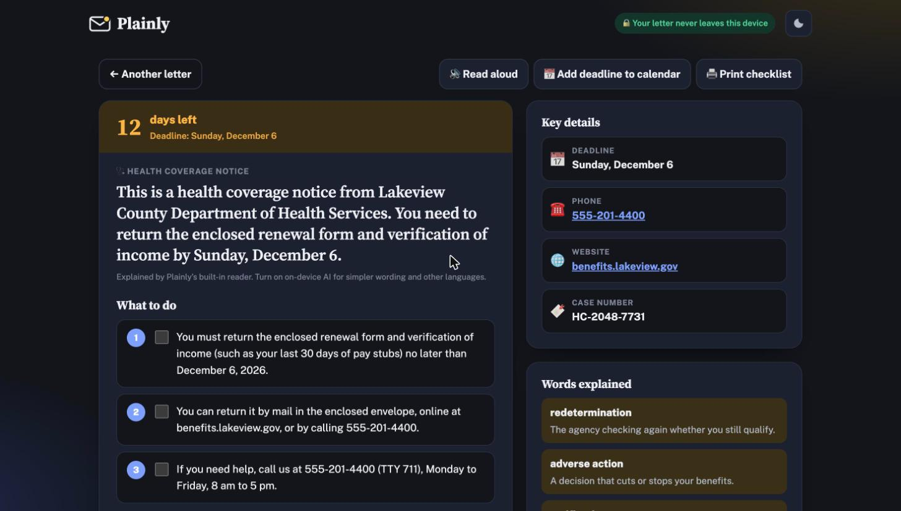

# Plainly ✉️

**Confusing letter? Get the plain version.**

Snap a photo or paste the text of a letter from an agency, landlord, utility, court or school. Plainly tells you **what it is, what to do, and by when**: in plain words, in your language, read out loud. Everything runs on your device.

**Live:** https://davidandree.github.io/plainly/. Try a sample letter in one click.



## The problem

Official mail is written in language most people struggle with, and missing one letter can cost you your health coverage, your power, or your home.

- During the 2023–24 Medicaid "unwinding," **more than 25 million people** were disenrolled, and the large majority for **procedural reasons**: renewal paperwork that wasn't returned or completed in time, not because they no longer qualified (KFF Medicaid Enrollment and Unwinding Tracker).
- About **1 in 5 U.S. adults** have low literacy skills (NCES, PIAAC). Millions more read English as a second language, have dyslexia or low vision, or are simply overwhelmed.
- Today the help is a person: a librarian, legal aid worker, caseworker or relative who reads the letter with you. There aren't enough of them, and pasting a Medicaid letter (full of personal details) into a cloud chatbot is a real privacy risk.

## What Plainly does

| | |
|---|---|
| 📷 **Reads the letter** | Photo (on-device OCR with Tesseract), PDF (text layer, or OCR for scans), or pasted text |
| 🚦 **Deadline first** | A big countdown ("6 days left: act now"), color-coded by urgency. It picks the *act-by* date, not the date of the notice or the coverage-end date |
| ✅ **What to do** | A numbered checklist of the actions the letter actually asks for, which you can tick off |
| ⚠️ **If you do nothing** | The consequence, in one line |
| 🔖 **Key details** | Amount due, tap-to-call phone numbers, website, case or account numbers |
| 📖 **Words explained** | 45 common official-letter terms (redetermination, adverse action, notice to quit, default judgment…) explained and highlighted in the original |
| 🧠 **On-device AI (optional)** | Rewrites the letter at a ~5th-grade level in **8 languages** (English, Español, 中文, Tiếng Việt, Tagalog, Français, Português, العربية), and writes a **phone script** for calling the office |
| 🔊 **Read aloud** | In the chosen language, using the browser's built-in voices |
| 📅 **Calendar** | One-tap `.ics` with reminders 3 days and 1 day before the deadline |
| 🖨️ **Print** | A clean checklist to stick on the fridge |

## How the AI is kept honest

Small models can misread or invent dates, and on a shut-off notice a wrong date is worse than none. So Plainly splits the work:

1. A **rule engine** (`docs/js/extract.js`) finds the facts deterministically: every date (with chrono-node), scored by deadline cues ("no later than," "on or before," "due") and penalized for "date of notice." It also finds money amounts, phone numbers, websites, reference numbers, action sentences and consequences, and it classifies the letter type.
2. The **on-device LLM** (Qwen2.5-1.5B-Instruct via WebLLM, on WebGPU) gets those verified facts and is told to use *only* them for dates, amounts and numbers. Its job is the part rules can't do: plain, warm wording, translation, and the phone script.
3. Without WebGPU, Plainly still works fully in English using the rule engine and the glossary, with plain-word swaps (remit → pay, terminated → ended).

## Privacy

There's no server, account, upload or analytics. OCR and AI both run in the browser. The AI model downloads once from Hugging Face's CDN and is cached; your letter is never sent anywhere.

## Market and who it's for

- **People:** Medicaid, SNAP and WIC households; renters; people behind on utilities; immigrants; older adults; anyone with dyslexia or low vision.
- **Organizations that already do this by hand:** public libraries, legal aid groups, community health workers, 211 helplines, school family liaisons and refugee resettlement agencies. Plainly is free for individuals. A natural sustainability path is white-label deployments for agencies and nonprofits (local glossary, local help numbers, their branding), and helping *senders* test their own letters for readability before mailing.

## Run it locally

```bash
git clone https://github.com/DavidAndree/plainly.git && cd plainly
npm install && npm test   # rule-engine tests on the sample letters
npm run serve             # http://localhost:8000
```

No build step and no API keys. The on-device AI needs a WebGPU browser (Chrome or Edge on desktop); everything else works in any modern browser.

## Project structure

```
docs/index.html      page (GitHub Pages)
docs/css/app.css     design: Public Sans (U.S. Web Design System typeface), light/dark, print stylesheet
docs/js/extract.js   rule engine + 45-term plain-language glossary
docs/js/ai.js        WebLLM: plain-language explanation (JSON schema) + streaming phone script
docs/js/app.js       UI: OCR, PDF, rendering, read aloud, calendar, print
docs/js/samples.js   three fictional sample letters (dates relative to today)
tests/               extractor tests
```

## Limitations

- OCR quality depends on the photo. Plainly shows the recognized text so you can fix it.
- The 1.5B on-device model is fast and private but not perfect, so dates and numbers always come from the rule engine. Always check the original letter.
- Plainly is not legal advice. It points people to 211 and LawHelp.org for free help.

## Credits and disclosure

Tesseract.js (OCR), PDF.js, chrono-node, WebLLM with Qwen2.5 (Apache 2.0), and the Public Sans and Source Serif 4 fonts. The sample letters are fictional.

**AI-assisted development:** built with Claude (Anthropic) as an AI coding assistant for code, design and docs. I directed, tested and submitted the project.

**License:** MIT
